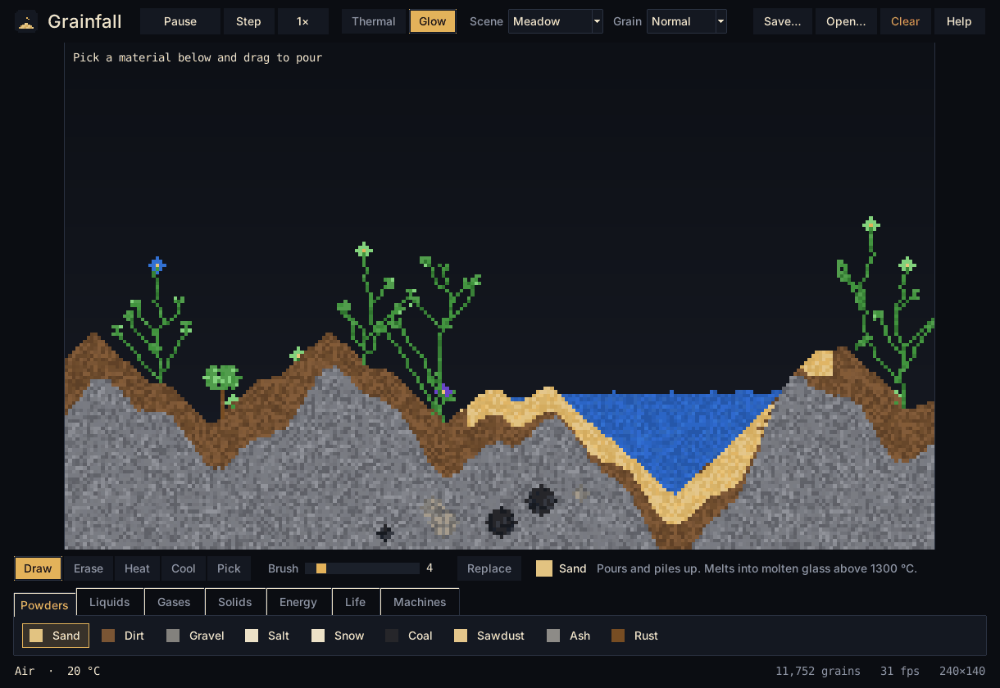

# Grainfall for Windows (Python + tkinter)

The desktop edition of Grainfall. It has the same 44 materials, physics and
scenes as the browser version, in a native window built with Python's tkinter.



## Option 1: download the ready-made .exe

You don't need Python for this one.

1. On GitHub, open the repository's **Actions** tab and pick the latest
   **Windows app** run.
2. Under **Artifacts**, download **Grainfall-windows** and unzip it.
3. Double-click `Grainfall.exe`.

Windows SmartScreen may warn about an unrecognised app, because the file
isn't code-signed. Click **More info → Run anyway**.

## Option 2: run it from source

1. Install Python 3.10 or newer from [python.org](https://www.python.org/downloads/).
   Tick **"Add python.exe to PATH"** in the installer. tkinter comes with it.
2. Double-click `start_windows.bat` in this folder.

The script installs the two dependencies (numpy and Pillow), then opens the game.

The same thing by hand, which also works on macOS and Linux:

```
cd desktop
python -m pip install -r requirements.txt
python run.py
```

## Option 3: build the .exe yourself

Double-click `build_windows.bat`, or run it from a terminal. It installs
PyInstaller, then writes a single self-contained `dist\Grainfall.exe` of about
35 MB that you can copy to any Windows PC.

## Controls

| Input | Action |
| --- | --- |
| Left-drag | Pour the selected material |
| Right-drag | Erase |
| Middle-click, or the **Pick** tool | Pick the material under the cursor |
| Mouse wheel, `[` `]` | Brush size |
| `Space` | Pause or resume |
| `.` | Advance one tick |
| `D` `E` `H` `C` `P` | Draw, erase, heat, cool, pick |
| `R` | Replace mode (paint over existing material) |
| `T` / `G` | Thermal camera / glow |
| `Ctrl+S` / `Ctrl+O` | Save / open a `.grainfall` world file |
| `F1` | Help |

The top bar also has playback speed, three starter scenes plus an empty
world, and grain size. Fine grain is the most detailed and the slowest. Coarse
is the fastest, which helps on older PCs.

## How it is built

```
run.py                 entry point (python run.py)
grainfall/elements.py  material definitions (same data as js/elements.js)
grainfall/sim.py       simulation: movement, heat, fire, electricity, explosions
grainfall/render.py    numpy renderer with glow and thermal view
grainfall/scenes.py    starter scenes
grainfall/app.py       tkinter window, controls and main loop
tests/test_sim.py      headless tests: python -m unittest discover tests
```

The rules for individual grains are plain Python running over compact
`bytearray`/`array` buffers. Heat diffusion and drawing work on numpy views of
the same memory, so they handle the whole grid at once. A tick takes about
8 ms at the normal grain size.
